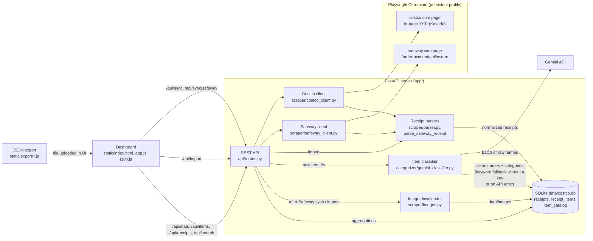

# DigitalCheckAI 🛒📊

A local web app that downloads receipts and orders from **costco.com** and **safeway.com**, decodes abbreviated product names (`Item #`) with the **Gemini API**, and visualizes spending by category for any period.

## Features
- **Every Costco.com purchase type**:
  - 🏪 Warehouse purchases (**In-Warehouse Receipts**)
  - ⛽ Fuel (**Costco Gas Station**)
  - 📦 Online orders (**Costco.com Online Orders**)
- **Safeway in-store purchases** with product photos and prices before and after discounts.
- **Search across all stores**, with price per pound and per ounce.
- **JSON import** for Costco and Safeway: ready-made export scripts for the browser console are in the "?" help next to the import button.
- **Correct coupon handling (Instant Savings / TPD)**: discount lines are attached to their `Item #` and subtracted from its amount (`net_amount`).
- **Smart categorization by `Item #`**:
  1. The first time a new `Item #` appears, its abbreviated receipt name (e.g. `KS ORG EVOO`) is sent to the **Gemini API** (`gemini-2.5-flash`), which returns a full readable name and a category.
  2. The result is stored in the local SQLite database (`data/costco.db` -> `item_catalog` table). Later purchases of the same `Item #` read it from the local database without calling Gemini again.
  3. You can **change any item's category or name by hand** at any time, right in the dashboard table, and the statistics for all receipts update immediately.

## Architecture



**Sync flow**
1. The dashboard calls `/api/sync` (Costco) or `/api/sync/safeway`. The client opens Chromium with a saved profile, waits for you to sign in, and fetches data from inside the store's page: Costco's orders API only accepts XHRs that carry Kasada headers added by its in-page script; Safeway's in-store API takes the session token from `window.AB.userInfo`.
2. `parser.py` (Costco) and `parse_safeway_receipt` (Safeway) normalize receipts into one format: coupons are attached to their items, weights and fuel volumes are computed, and fuel lines get the gas category up front.
3. `Database.upsert_receipts` stores receipts and lines and adds new `Item #`s to `item_catalog`. Items whose category the parser already knows (fuel, unmatched coupons) are marked `parser` and skip classification.
4. The classifier sends only new items to Gemini in batches (or uses a keyword fallback when no key is set or the API call fails). Manual edits (`is_manual_override`) are never overwritten.
5. After a Safeway sync or a JSON import, product images are downloaded to `data/images`. Statistics, search and membership analytics are SQL aggregations over the local database.

## Quick start (Windows)

Double-click **`run.bat`** or run in a terminal:

```powershell
python -m venv .venv
.\.venv\Scripts\pip install -r requirements.txt
.\.venv\Scripts\playwright install chromium
.\.venv\Scripts\python -m uvicorn app.main:app --host 127.0.0.1 --port 8000 --reload
```

Then open **http://localhost:8000** in your browser.

### Access from another computer on the local network
Run **`run.bat lan`**. The server listens on all network interfaces (`--host 0.0.0.0`, without `--reload`) and prints the addresses to open on other computers, e.g. `http://192.168.1.20:8000`. If the page does not open, allow port 8000 in Windows Firewall once (as administrator):

```powershell
netsh advfirewall firewall add rule name="DigitalCheckAI" dir=in action=allow protocol=TCP localport=8000 profile=private
```

Limitations:
- The app has no authentication: anyone on the network can view purchases, run syncs and change the Gemini key. Use it only on a trusted home network and do not expose the port to the internet.
- Sync (`/api/sync`, `/api/sync/safeway`) opens the store sign-in window on the **server** computer. Remote users should run the export scripts from `static/export/` in their own browser and upload the JSON with the import button.

## Gemini API key
1. Click **"Указать ключ Gemini API"** ("Set Gemini API key") in the top right corner of the dashboard, or set `GEMINI_API_KEY=...` in the `.env` file.
2. The key is stored locally in `.env`.

## Running tests
```powershell
.\.venv\Scripts\python -m pytest -v
```
