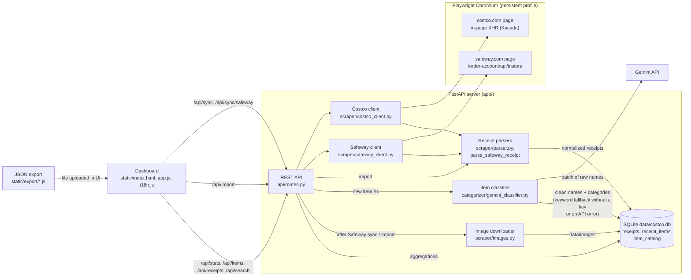

# DigitalCheckAI 🛒📊

A local web app that downloads receipts and orders from **costco.com** and **safeway.com**, decodes abbreviated product names (`Item #`) with the **Gemini API**, and visualizes spending by category for any period.

## Features
- **Every Costco.com purchase type**:
  - 🏪 Warehouse purchases (**In-Warehouse Receipts**)
  - ⛽ Fuel (**Costco Gas Station**)
  - 📦 Online orders (**Costco.com Online Orders**)
- **Safeway in-store purchases** with product photos and prices before and after discounts.
- **Search across all stores**, with price per pound and per ounce.
- **JSON import** for Costco and Safeway: ready-made export scripts for the browser console are in the "?" help next to the import button.
- **Correct coupon handling (Instant Savings / TPD)**: discount lines are attached to their `Item #` and subtracted from its amount (`net_amount`).
- **Smart categorization by `Item #`**:
  1. The first time a new `Item #` appears, its abbreviated receipt name (e.g. `KS ORG EVOO`) is sent to the **Gemini API** (`gemini-2.5-flash`), which returns a full readable name and a category.
  2. The result is stored in the local SQLite database (`data/costco.db` -> `item_catalog` table). Later purchases of the same `Item #` read it from the local database without calling Gemini again.
  3. You can **change any item's category or name by hand** at any time, right in the dashboard table, and the statistics for all receipts update immediately.

## Purchase categories

The dashboard has 18 defaults, with English names and Russian labels:

| English | Russian |
| --- | --- |
| Meat, poultry & seafood | Мясо, птица и морепродукты |
| Fruits & vegetables | Овощи и фрукты |
| Dairy & eggs | Молочные продукты и яйца |
| Bread & bakery | Хлеб и выпечка |
| Prepared meals & deli | Готовая еда |
| Frozen foods | Замороженные продукты |
| Pantry & cooking ingredients | Бакалея и продукты для готовки |
| Snacks & sweets | Снеки и сладости |
| Beverages, coffee & tea | Напитки, кофе и чай |
| Alcohol | Алкоголь |
| Household supplies & cleaning | Бытовые расходники и уборка |
| Health & personal care | Здоровье и личная гигиена |
| Home, kitchen & garden | Дом, кухня и сад |
| Clothing, shoes & accessories | Одежда, обувь и аксессуары |
| Electronics & appliances | Электроника и бытовая техника |
| Auto & fuel | Авто и топливо |
| Toys & games | Игрушки и игры |
| Other | Прочее |

Frozen food takes priority over its ingredients; freeze-dried fruit stays in Snacks & sweets. Dairy drinks
stay in Dairy & eggs, plant-based milk goes to Beverages, coffee & tea, and alcoholic drinks go to Alcohol.
Household supplies are consumables; reusable goods go to Home, kitchen & garden, and kitchen appliances
go to Electronics & appliances. Attached discounts and bottle deposits count toward their item's category.
You can add custom categories such as Pets or Baby supplies when needed.

On first startup after the upgrade, existing category names are migrated locally. Recognizable prepared
meals and beverages are separated from the former combined categories; ambiguous items stay in Bread &
bakery or Snacks & sweets. Automatically categorized LEGO, coffee and kitchen appliances are moved to
their new categories. Custom categories, product names, manual override flags and receipt amounts are
preserved. The upgrade does not call Gemini.

## Architecture



**Sync flow**
1. The dashboard calls `/api/sync` (Costco) or `/api/sync/safeway`. The client opens Chromium with a saved profile, waits for you to sign in, and fetches data from inside the store's page: Costco's orders API only accepts XHRs that carry Kasada headers added by its in-page script; Safeway's in-store API takes the session token from `window.AB.userInfo`.
2. `parser.py` (Costco) and `parse_safeway_receipt` (Safeway) normalize receipts into one format: coupons are attached to their items, weights and fuel volumes are computed, and fuel lines get the gas category up front.
3. `Database.upsert_receipts` stores receipts and lines and adds new `Item #`s to `item_catalog`. Items whose category the parser already knows (fuel, unmatched coupons) are marked `parser` and skip classification.
4. The classifier sends only new items to Gemini in batches (or uses a keyword fallback when no key is set or the API call fails). Manual edits (`is_manual_override`) are never overwritten.
5. After a Safeway sync or a JSON import, product images are downloaded to `data/images`. Statistics, search and membership analytics are SQL aggregations over the local database.

## Quick start (Windows)

Requires **Python 3.11+**. Double-click **`run.bat`** or run in a terminal:

```powershell
python -m venv .venv
.\.venv\Scripts\pip install -r requirements.txt
.\.venv\Scripts\playwright install chromium
.\.venv\Scripts\python -m uvicorn app.main:app --host 127.0.0.1 --port 8000 --reload
```

Then open **http://localhost:8000** in your browser.

## Gemini API key
1. Install or update dependencies with `python -m pip install -r requirements.txt`, then click **"Указать ключ Gemini API"** ("Set Gemini API key") in the top right corner of the dashboard.
2. The key is saved in the operating system's credential store: Windows Credential Locker, macOS Keychain, or Linux Secret Service. Saving requires an available, unlocked credential store; plaintext storage is never used as a fallback. On first use, existing `GEMINI_API_KEY` assignments in `.env` are migrated and removed only after secure storage succeeds. Other settings remain in `.env`.
3. For headless use, inject `GEMINI_API_KEY` into the server process environment using your secret manager. A saved credential takes precedence over the environment. Do not put real keys in `.env`; migrate any existing key on a system with an available credential store first. Credentials previously stored in `.env` may remain in old backups; rotate those keys in Google AI Studio and save the replacement in the dashboard.
4. To see exactly what is sent to Gemini, add `LOG_LEVEL=DEBUG` to `.env` and restart the server. The console then shows every batch prompt, the raw JSON response, the call duration and token counts (the API key is never logged). The default level is `INFO`.

## Running tests
```powershell
.\.venv\Scripts\python -m pytest -v
```
